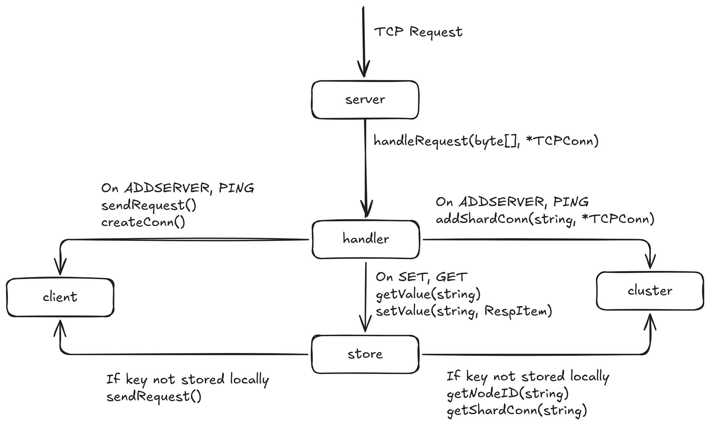

# KeyValue
**A distributed, in-memory key-value database written in Go (inspired by Redis).**
<br>
**Main branch is unstable, please use the [stable branch](https://github.com/trivaris/keyvalue/tree/stable) for testing**
<br>


## Features & Roadmap

**What Works:**
- [x] TCP-based client & peer-to-peer API
- [x] Concurrent request handling
- [x] Custom RESP2 protocol parser
- [x] Cluster state managed via consistent hashing (Hashring)
- [x] Dedicated CLI client for sending commands

**Roadmap / To-Do:**
- [ ] Graceful node departure from the cluster
- [ ] Heartbeat / Keepalive checks between nodes
- [ ] Marking cluster as "down" when a node goes offline *(Prioritizing Consistency over Availability / CP model)*
- [ ] Virtual nodes on the Hashring (groundwork is implemented)
- [ ] Concurrency optimizations

---

## RESP2 Protocol Implementation

### Data Types
Based on the official [Redis Protocol Specification](https://redis.io/docs/latest/develop/reference/protocol-spec/):
- **RespString**: Corresponds to RESP Bulk String
- **RespInteger**: Corresponds to RESP Integer
- **RespArray**: Corresponds to RESP Array
- **RespError**: Corresponds to RESP Error
- **RespNull**: `RespString` of length `-1`

### Supported Commands

#### `GET [keys...]`
- Reads values of `<keys>`
- **Returns:** `RespArray` of corresponding values, or `RespError`

#### `SET <key> <value>`
- Sets `<key>` to `<value>`
- **Returns:** `"Success!"` (`RespString`), or `RespError`

#### `ADDSERVER <name> <address>`
- Connects to `<address>`, saves the connection in the cluster under `<name>`, and initiates a `PING` handshake.
- **Returns:** `"Success!"` (`RespString`), or `RespError`

#### `PING <name> <port>`
- Registers the incoming node in the local cluster state without echoing a `PING` back (acts as the receiver for `ADDSERVER`).

---

## Building & Running

### Option 1: Docker Compose (Recommended for Cluster Testing)
Spin up two independent nodes (`node1` and `node2`) on the same Docker network:
```bash
docker compose up --build
```

* `node1` listens internally on `node1:8080` (exposed on host port `8080`)
* `node2` listens internally on `node2:8080` (exposed on host port `8081`)

Connect the two nodes into a cluster using netcat (`nc`):

```bash
printf "*3\r\n\$9\r\nADDSERVER\r\n\$5\r\nnode1\r\n\$10\r\nnode1:8080\r\n" | nc localhost 8081

```

To build and run a single container manually:

```bash
docker build . -t keyvalue:latest
docker run -p 8080:8080 keyvalue:latest

```

### Option 2: Nix

This repository provides a Nix flake:

* **Build:** `nix build` (binary output at `./result/bin/keyvalue`)
* **Run directly:** `nix run` (or target a specific architecture via `nix run .#packages.<architecture>.keyvalue`)

### Option 3: Go Toolchain

Build and run directly with Go:

```bash
go build -o keyvalue ./cmd/server/
./keyvalue <node-name>

```
